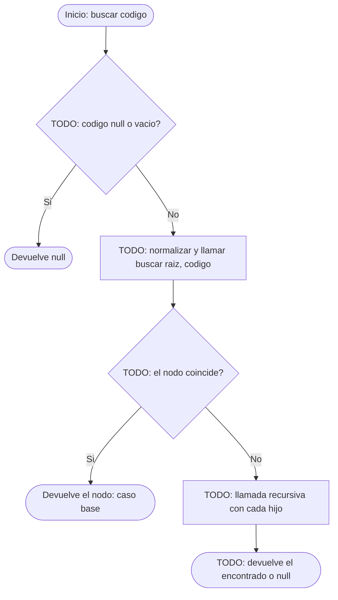
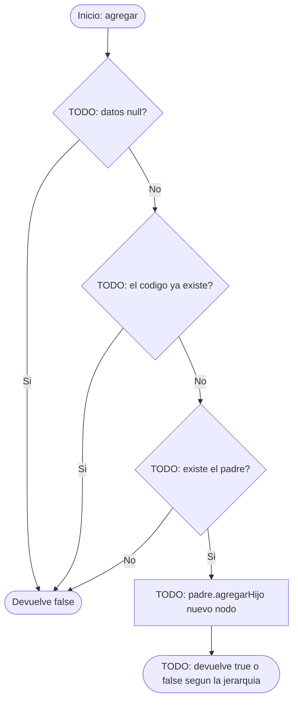

# Diagramas de flujo: agregar y buscar (arbol general)

> **Responsable:** Damian · **Rama:** `Damian_Cunalata`
>
> **Para que:** mostrar las decisiones de buscar (recursivo) y de agregar (codigo unico, padre y jerarquia).
>
> Esqueleto: reemplazar cada `TODO` y borrar solo esta linea al terminar (dejar Responsable y Rama).

Convencion de formas (igual que el Grupo 1): inicio y fin en rectangulo redondeado, proceso en rectangulo, decision en rombo, error en rectangulo rojo. La llamada recursiva es un paso explicito, no un ciclo de regreso al inicio.

## Metodo buscar(codigo)
Clase: ArbolOrganizacional | Archivo: src/negocio/ArbolOrganizacional.java

Firma: `public NodoUnidad buscar(String codigo)`

TODO: parrafo que recorra el diagrama con el ejemplo (buscar "sw-n3-b"): que decide primero, cual es el caso base, donde esta la llamada recursiva y que devuelve.

## Metodo agregar(codigoPadre, unidad)
Clase: ArbolOrganizacional | Archivo: src/negocio/ArbolOrganizacional.java

Firma: `public boolean agregar(String codigoPadre, UnidadAcademica unidad)`

TODO: parrafo que recorra el diagrama con el ejemplo (agregar SW-N3-C bajo SW-N3): que decide primero, cual es el caso base, donde esta la llamada recursiva y que devuelve.

