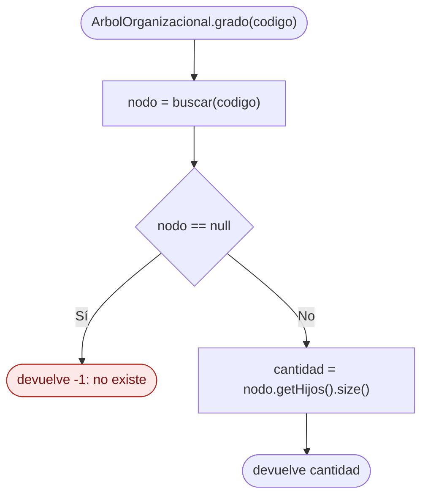
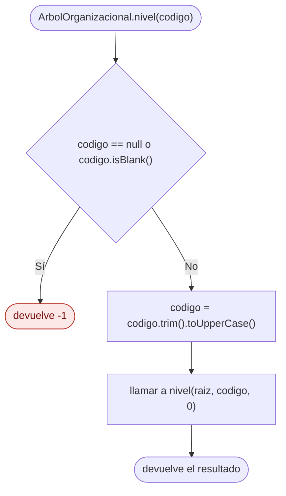
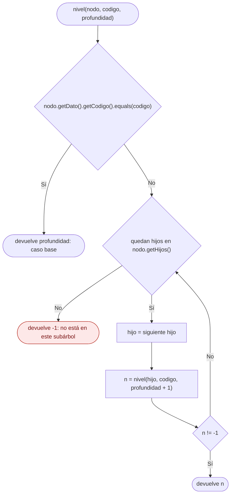

# Diagramas de flujo: grado y nivel (árbol general)

> **Responsable:** Luis · **Rama:** `Rama-Luis-Silva`
>
> **Para qué:** mostrar cómo se obtiene el grado (cantidad de hijos) y el nivel (distancia a la raíz) de una unidad.

Cada diagrama sigue el código de `src/negocio/ArbolOrganizacional.java`: las mismas condiciones y los mismos resultados.

Convención de formas (igual que el Grupo 1): inicio y fin en rectángulo redondeado, proceso en rectángulo, decisión en rombo, error en rectángulo rojo. La llamada recursiva es un paso explícito, no un ciclo de regreso al inicio. Aquí el rojo es el resultado `-1`, porque estos métodos no lanzan excepciones: si el código no existe, devuelven `-1`.

## Índice

| Método | Clase | Capa | Archivo fuente |
|---|---|---|---|
| [grado(codigo)](#grado) | `ArbolOrganizacional` | negocio | `src/negocio/ArbolOrganizacional.java` |
| [nivel(codigo)](#nivel) | `ArbolOrganizacional` | negocio | `src/negocio/ArbolOrganizacional.java` |
| [nivel(nodo, codigo, profundidad)](#nivelNodo) | `ArbolOrganizacional` | negocio | `src/negocio/ArbolOrganizacional.java` |

## Capa negocio, clase ArbolOrganizacional

### Método grado(codigo)
Paquete principal: SJA-UTA | Capa: negocio | Paquete: negocio | Clase: ArbolOrganizacional | Archivo: src/negocio/ArbolOrganizacional.java

Firma: `public int grado(String codigo)`

El grado de una unidad es la cantidad de hijos que tiene. El método reutiliza el `buscar` recursivo de Damian: si no encuentra la unidad devuelve `-1`; si la encuentra, devuelve el tamaño de su lista de hijos. Complejidad O(n) por la búsqueda.

Ejemplo: `FISEI` tiene grado 5, `UTA` tiene grado 10 y `SW-N3-B`, que es una hoja, tiene grado 0.

### Método nivel(codigo)
Paquete principal: SJA-UTA | Capa: negocio | Paquete: negocio | Clase: ArbolOrganizacional | Archivo: src/negocio/ArbolOrganizacional.java

Firma: `public int nivel(String codigo)`

El método público solo valida y normaliza el código, igual que `buscar`, y delega en el método privado recursivo empezando en la raíz con profundidad 0.

### Método nivel(nodo, codigo, profundidad)
Paquete principal: SJA-UTA | Capa: negocio | Paquete: negocio | Clase: ArbolOrganizacional | Archivo: src/negocio/ArbolOrganizacional.java

Firma: `private int nivel(NodoUnidad nodo, String codigo, int profundidad)`

Cada llamada pregunta si el nodo actual es el buscado; si coincide, devuelve la profundidad acumulada (**caso base**). Si no, se llama a sí misma con cada hijo sumando 1 a la profundidad (**caso recursivo**), y devuelve el primer resultado distinto de `-1`. Si ningún hijo lo contiene, devuelve `-1` y la llamada anterior sigue con el siguiente hermano. Complejidad O(n).

Ejemplo: para `SW-N3-B` la profundidad sube así: UTA 0, FISEI 1, SW 2, SW-N3 3 y SW-N3-B 4.