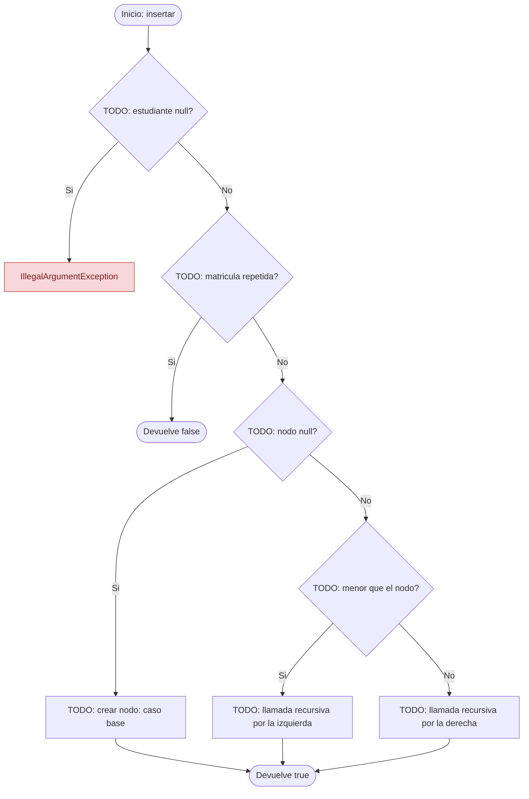
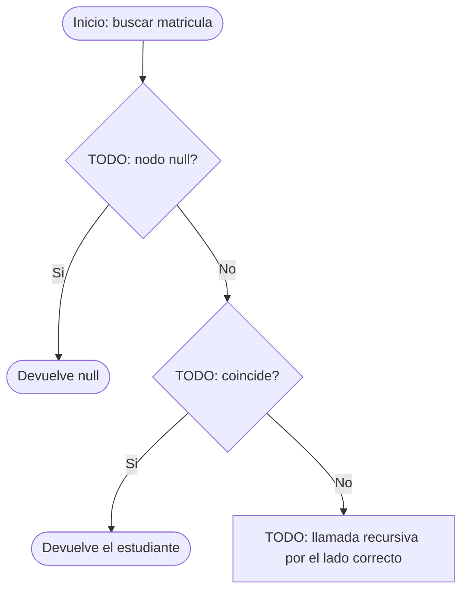

# Diagramas de flujo: insertar y buscar (ABB)

> **Responsable:** Kenneth · **Rama:** `Mateo-Chalco`
>
> **Para que:** mostrar como insertar decide izquierda o derecha hasta llegar al lugar libre.
>
> Esqueleto: reemplazar cada `TODO` y borrar solo esta linea al terminar (dejar Responsable y Rama).

Convencion de formas (igual que el Grupo 1): inicio y fin en rectangulo redondeado, proceso en rectangulo, decision en rombo, error en rectangulo rojo. La llamada recursiva es un paso explicito, no un ciclo de regreso al inicio.

## Metodo insertar(estudiante)
Clase: ArbolEstudiantes | Archivo: src/negocio/ArbolEstudiantes.java

Firma: `public boolean insertar(Estudiante estudiante)`

TODO: parrafo que recorra el diagrama con el ejemplo (insertar 45 en SW-N3-B): que decide primero, cual es el caso base, donde esta la llamada recursiva y que devuelve.

## Metodo buscar(matricula)
Clase: ArbolEstudiantes | Archivo: src/negocio/ArbolEstudiantes.java

Firma: `public Estudiante buscar(int matricula)`

TODO: parrafo que recorra el diagrama con el ejemplo (buscar 99): que decide primero, cual es el caso base, donde esta la llamada recursiva y que devuelve.

