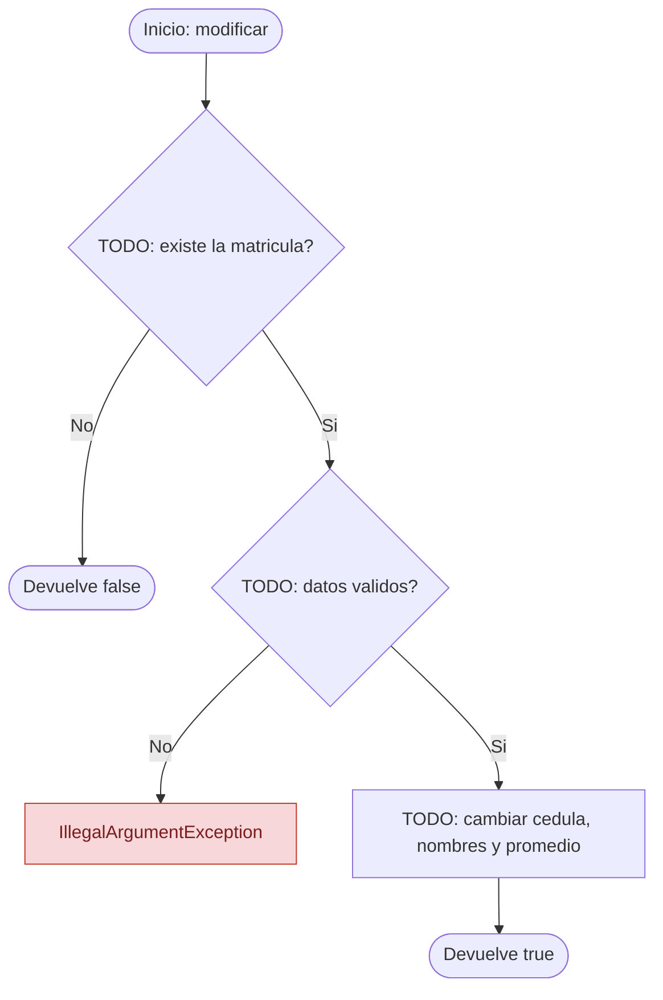
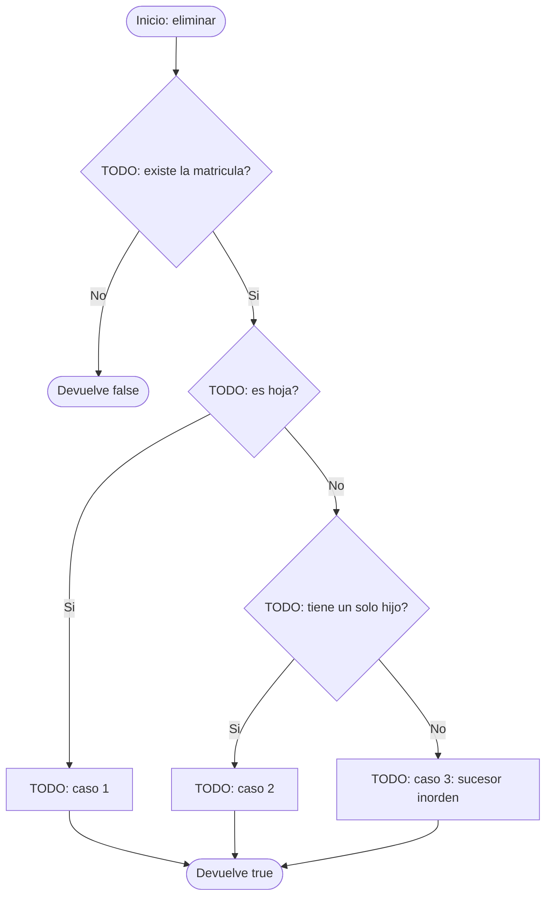

# Diagramas de flujo: modificar y eliminar (ABB)

> **Responsable:** Luis · **Rama:** `Rama-Luis-Silva`
>
> **Para que:** mostrar las decisiones de modificar y los 3 casos de eliminar.
>
> Esqueleto: reemplazar cada `TODO` y borrar solo esta linea al terminar (dejar Responsable y Rama).

Convencion de formas (igual que el Grupo 1): inicio y fin en rectangulo redondeado, proceso en rectangulo, decision en rombo, error en rectangulo rojo. La llamada recursiva es un paso explicito, no un ciclo de regreso al inicio.

## Metodo modificar(matricula, cedula, nombres, promedio)
Clase: ArbolEstudiantes | Archivo: src/negocio/ArbolEstudiantes.java

Firma: `public boolean modificar(int matricula, String cedula, String nombres, double promedio)`

TODO: parrafo que recorra el diagrama con el ejemplo (modificar el 45): que decide primero, cual es el caso base, donde esta la llamada recursiva y que devuelve.

## Metodo eliminar(matricula)
Clase: ArbolEstudiantes | Archivo: src/negocio/ArbolEstudiantes.java

Firma: `public boolean eliminar(int matricula)`

TODO: parrafo que recorra el diagrama con el ejemplo (eliminar 20, 60 y 50): que decide primero, cual es el caso base, donde esta la llamada recursiva y que devuelve.

