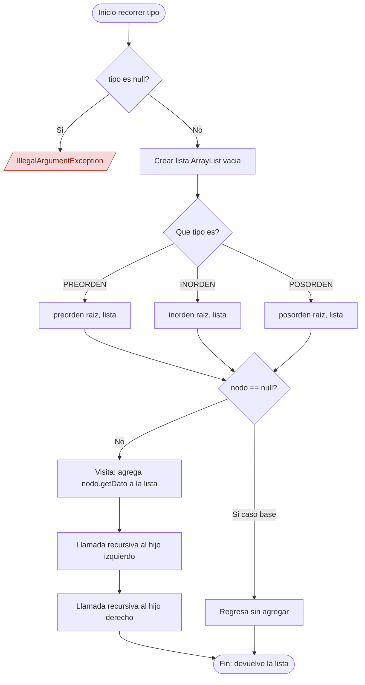

# Flujo de recorridos

Firma: `public List<Estudiante> recorrer(TipoRecorrido tipo)`

El metodo `recorrer` valida el tipo: si es `null` lanza `IllegalArgumentException`. Luego crea una lista vacia y llama al metodo recursivo segun el tipo. Cada llamada termina en el caso base `nodo == null`. En preorden la visita va antes de las llamadas a los hijos, en inorden entre ellas y en posorden despues. Si el arbol esta vacio devuelve la lista vacia, nunca `null`. Cada nodo se visita una vez, por eso la complejidad es O(n).
