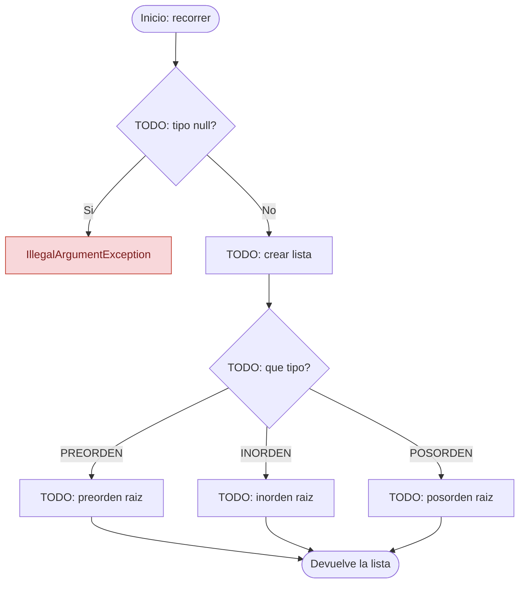
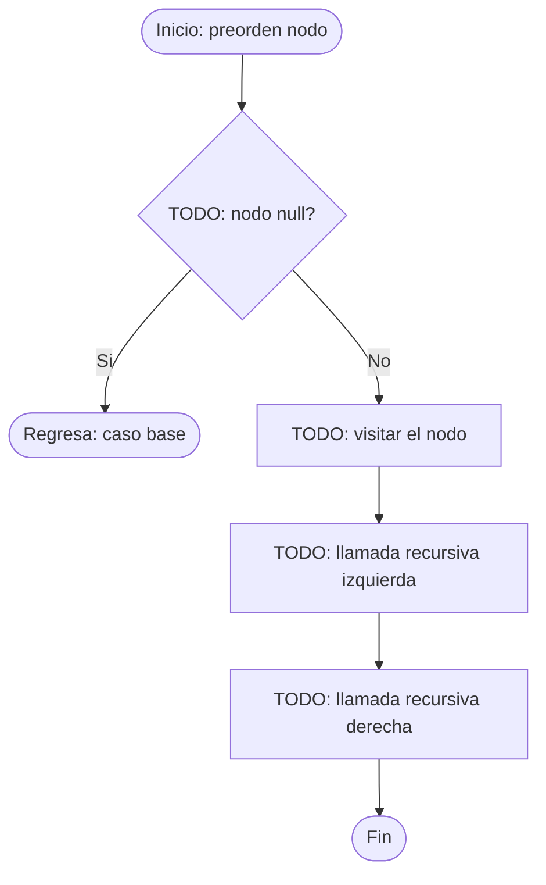
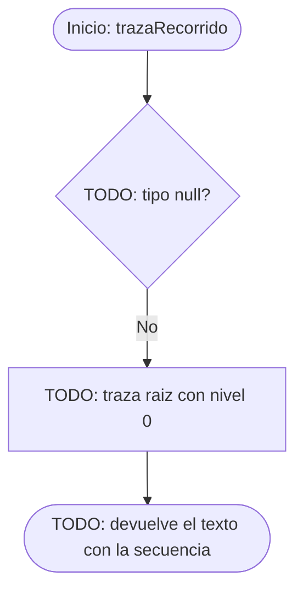

# Diagramas de flujo: recorridos y traza (ABB)

> **Responsable:** Darwin · **Rama:** `Rama-Joel`
>
> **Para que:** mostrar que pre, in y pos tienen la misma forma y solo cambia el momento de visitar.
>
> Esqueleto: reemplazar cada `TODO` y borrar solo esta linea al terminar (dejar Responsable y Rama).

Convencion de formas (igual que el Grupo 1): inicio y fin en rectangulo redondeado, proceso en rectangulo, decision en rombo, error en rectangulo rojo. La llamada recursiva es un paso explicito, no un ciclo de regreso al inicio.

## Metodo recorrer(tipo)
Clase: ArbolEstudiantes | Archivo: src/negocio/ArbolEstudiantes.java

Firma: `public List<Estudiante> recorrer(TipoRecorrido tipo)`

TODO: parrafo que recorra el diagrama con el ejemplo (PREORDEN en SW-N3-B): que decide primero, cual es el caso base, donde esta la llamada recursiva y que devuelve.

## Metodo preorden(nodo, lista)
Clase: ArbolEstudiantes | Archivo: src/negocio/ArbolEstudiantes.java

Firma: `private void preorden(NodoEstudiante nodo, List<Estudiante> lista)`

TODO: parrafo que recorra el diagrama con el ejemplo (50 30 20 40 35 45 70 60 65 80): que decide primero, cual es el caso base, donde esta la llamada recursiva y que devuelve.

## Metodo trazaRecorrido(tipo)
Clase: ArbolEstudiantes | Archivo: src/negocio/ArbolEstudiantes.java

Firma: `public String trazaRecorrido(TipoRecorrido tipo)`

TODO: parrafo que recorra el diagrama con el ejemplo (opcion 14 con PREORDEN): que decide primero, cual es el caso base, donde esta la llamada recursiva y que devuelve.

