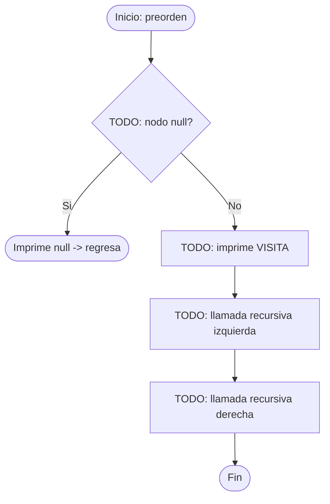
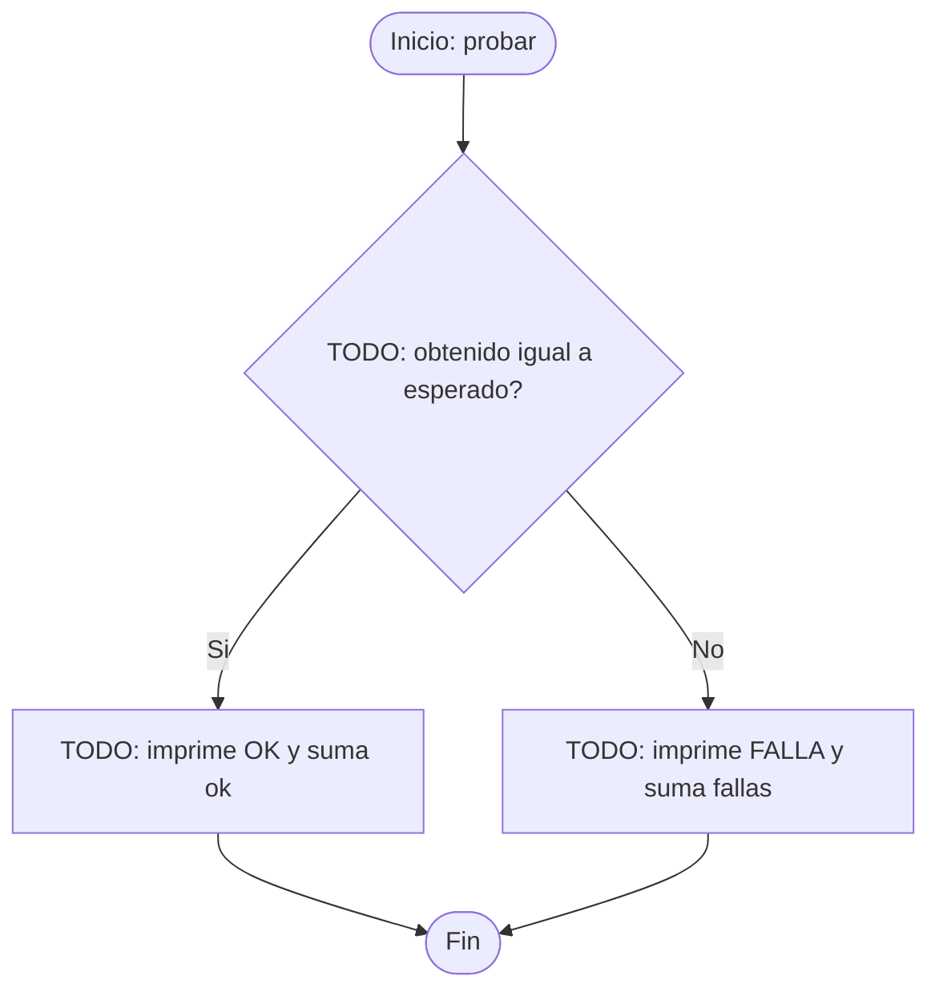

# Diagramas de flujo: reto de recorridos (SW-N3-A)

> **Responsable:** Monica · **Rama:** `Sara-Tacuri`
>
> **Para que:** mostrar el flujo del preorden con traza y de la funcion de pruebas.
>
> Esqueleto: reemplazar cada `TODO` y borrar solo esta linea al terminar (dejar Responsable y Rama).

Convencion de formas (igual que el Grupo 1): inicio y fin en rectangulo redondeado, proceso en rectangulo, decision en rombo, error en rectangulo rojo. La llamada recursiva es un paso explicito, no un ciclo de regreso al inicio.

## Metodo preorden(nodo, sangria)
Clase: RetoSolucion | Archivo: reto/solucion/RetoSolucion.java

Firma: `static void preorden(NodoEstudiante nodo, String sangria)`

TODO: parrafo que recorra el diagrama con el ejemplo (45 25 10 30 27 70 60 65 90): que decide primero, cual es el caso base, donde esta la llamada recursiva y que devuelve.

## Metodo probar(nombre, esperado)
Clase: RetoSolucion | Archivo: reto/solucion/RetoSolucion.java

Firma: `static void probar(String nombre, String esperado)`

TODO: parrafo que recorra el diagrama con el ejemplo (Preorden del reto): que decide primero, cual es el caso base, donde esta la llamada recursiva y que devuelve.

