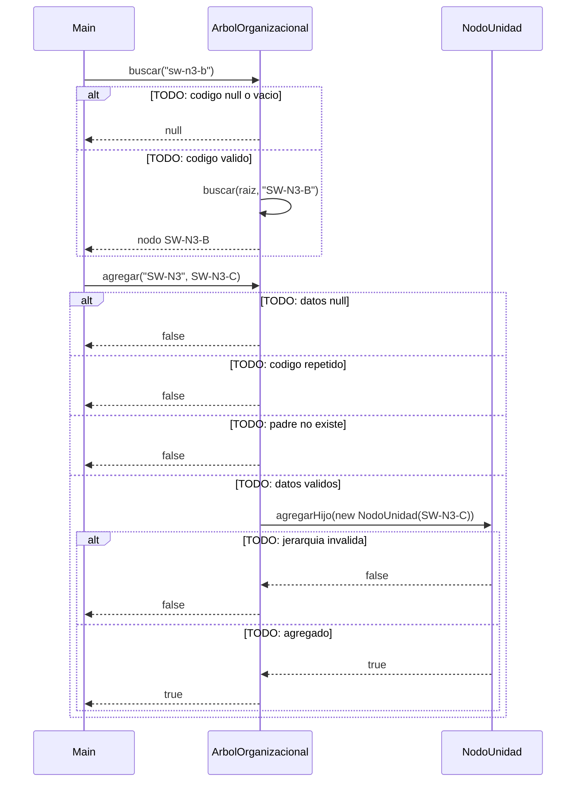

# Diagrama de secuencia: agregar y buscar (arbol general)

> **Responsable:** Damian · **Rama:** `Damian_Cunalata`
>
> **Para que:** explicar como se busca recursivamente una unidad entre las 88 y como se agrega respetando codigo unico y jerarquia.
>
> Esqueleto: reemplazar cada `TODO` y borrar solo esta linea al terminar (dejar Responsable y Rama).

La flecha continua es una llamada. La flecha punteada es una respuesta. El bloque `alt` separa el camino normal de los errores. Los nombres de metodos, condiciones y mensajes deben ser los mismos del codigo.

## agregar y buscar (arbol general)

TODO: una linea que diga que operacion se muestra y con que datos (buscar "sw-n3-b" y agregar SW-N3-C bajo SW-N3).

TODO: parrafo que explique el diagrama paso a paso con el ejemplo (buscar "sw-n3-b" y agregar SW-N3-C bajo SW-N3): que revisa primero, cual es el caso base, cual es la llamada recursiva, que devuelve y su complejidad.
