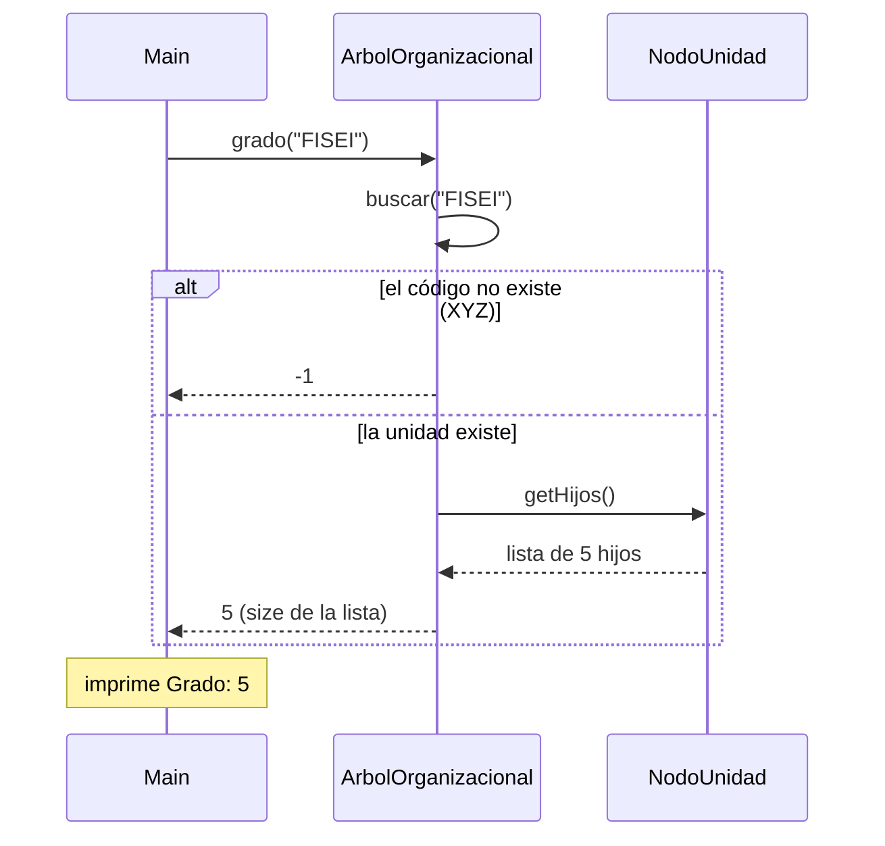
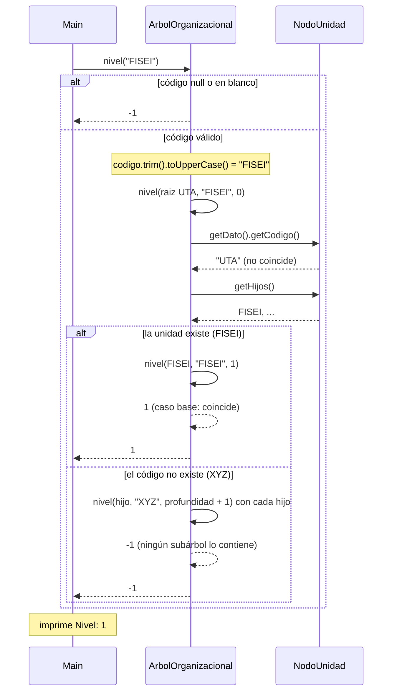

# Diagrama de secuencia: grado y nivel (árbol general)

> **Responsable:** Luis · **Rama:** `Rama-Luis-Silva`
>
> **Para qué:** explicar cómo se calculan el grado y el nivel de una unidad, y qué ocurre cuando el código no existe.

Un diagrama de secuencia muestra el orden de las llamadas entre objetos durante una operación. La flecha continua es una llamada. La flecha punteada es una respuesta. El bloque `alt` separa el camino normal de los casos de error. Los nombres de métodos, condiciones y mensajes son los mismos del código.

## Paquete negocio

### Grado de una unidad

`Main` (opción 5) pide el grado del código `FISEI`.

`grado` usa el `buscar` recursivo para encontrar la unidad. Si no la encuentra, como con `XYZ`, responde `-1`. Si la encuentra, pide su lista de hijos con `getHijos()` y devuelve cuántos son: `FISEI` tiene 5, `UTA` tiene 10 y `SW-N3-B`, que es hoja, tiene 0. Complejidad **O(n)** por la búsqueda.

### Nivel de una unidad

`Main` (opción 5) pide el nivel del código `FISEI`.

`nivel` valida y normaliza el código, y delega en el método recursivo desde la raíz `UTA`, que está en el nivel 0. Cada llamada pregunta si el nodo es el buscado; si coincide devuelve la profundidad (**caso base**), y si no se llama con cada hijo sumando 1 (**caso recursivo**). Para `FISEI` la respuesta sube en una sola llamada: `1`. Para `SW-N3-B` la profundidad va 0, 1, 2, 3 y 4. Con `XYZ` ninguna llamada lo encuentra y devuelve `-1`. Complejidad **O(n)**.