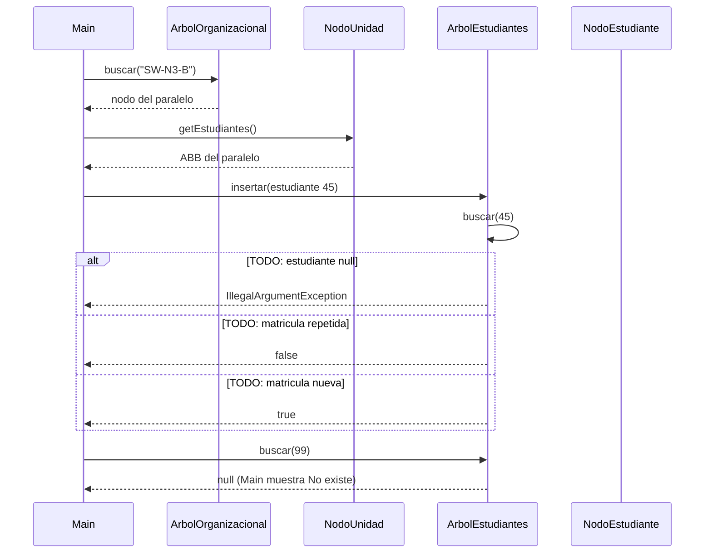

# Diagrama de secuencia: insertar y buscar (ABB)

> **Responsable:** Kenneth · **Rama:** `Mateo-Chalco`
>
> **Para que:** explicar la insercion recursiva: el 45 baja comparandose hasta un lugar libre (caso base).
>
> Esqueleto: reemplazar cada `TODO` y borrar solo esta linea al terminar (dejar Responsable y Rama).

La flecha continua es una llamada. La flecha punteada es una respuesta. El bloque `alt` separa el camino normal de los errores. Los nombres de metodos, condiciones y mensajes deben ser los mismos del codigo.

## insertar y buscar (ABB)

TODO: una linea que diga que operacion se muestra y con que datos (insertar(45) en SW-N3-B: 50, 30, 40, null; y buscar(99)).

TODO: parrafo que explique el diagrama paso a paso con el ejemplo (insertar(45) en SW-N3-B: 50, 30, 40, null; y buscar(99)): que revisa primero, cual es el caso base, cual es la llamada recursiva, que devuelve y su complejidad.
