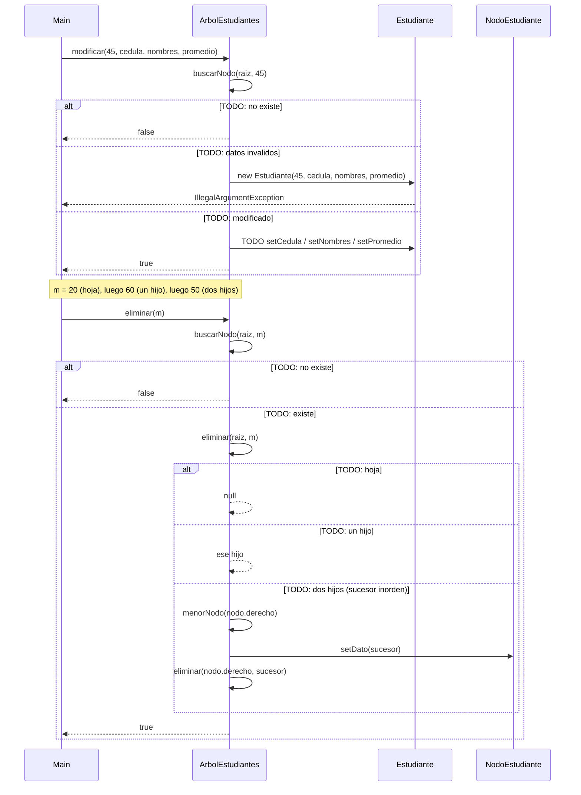

# Diagrama de secuencia: modificar y eliminar (ABB)

> **Responsable:** Luis · **Rama:** `Rama-Luis-Silva`
>
> **Para que:** explicar que modificar no toca la matricula y los 3 casos de eliminacion.
>
> Esqueleto: reemplazar cada `TODO` y borrar solo esta linea al terminar (dejar Responsable y Rama).

La flecha continua es una llamada. La flecha punteada es una respuesta. El bloque `alt` separa el camino normal de los errores. Los nombres de metodos, condiciones y mensajes deben ser los mismos del codigo.

## modificar y eliminar (ABB)

TODO: una linea que diga que operacion se muestra y con que datos (modificar el 45; eliminar 20, 60 y 50 en secuencia).

TODO: parrafo que explique el diagrama paso a paso con el ejemplo (modificar el 45; eliminar 20, 60 y 50 en secuencia): que revisa primero, cual es el caso base, cual es la llamada recursiva, que devuelve y su complejidad.
