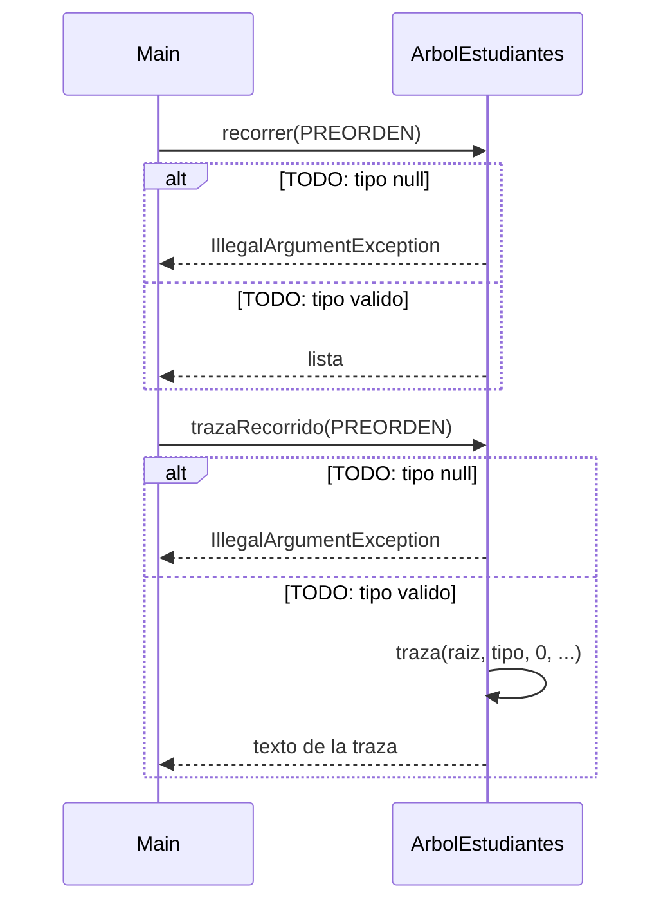

# Diagrama de secuencia: recorridos y traza (ABB)

> **Responsable:** Darwin · **Rama:** `Rama-Joel`
>
> **Para que:** explicar como los recorridos se llaman a si mismos y que lo unico que cambia entre pre, in y pos es el momento del VISITA.
>
> Esqueleto: reemplazar cada `TODO` y borrar solo esta linea al terminar (dejar Responsable y Rama).

La flecha continua es una llamada. La flecha punteada es una respuesta. El bloque `alt` separa el camino normal de los errores. Los nombres de metodos, condiciones y mensajes deben ser los mismos del codigo.

## recorridos y traza (ABB)

TODO: una linea que diga que operacion se muestra y con que datos (recorrer(PREORDEN) en SW-N3-B con el 45: 50 30 20 40 35 45 70 60 65 80).

TODO: parrafo que explique el diagrama paso a paso con el ejemplo (recorrer(PREORDEN) en SW-N3-B con el 45: 50 30 20 40 35 45 70 60 65 80): que revisa primero, cual es el caso base, cual es la llamada recursiva, que devuelve y su complejidad.
