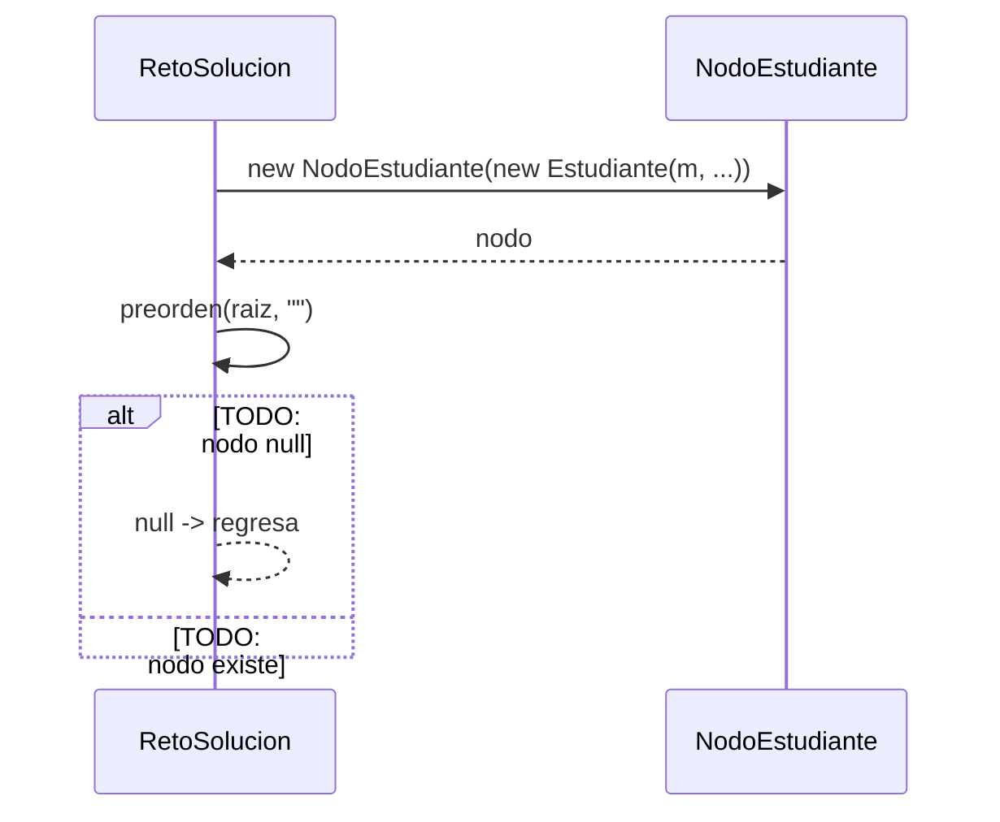

# Diagrama de secuencia: reto de recorridos (SW-N3-A)

> **Responsable:** Monica · **Rama:** `Sara-Tacuri`
>
> **Para que:** explicar como se construye el ABB del reto y como el preorden recursivo produce la traza.
>
> Esqueleto: reemplazar cada `TODO` y borrar solo esta linea al terminar (dejar Responsable y Rama).

La flecha continua es una llamada. La flecha punteada es una respuesta. El bloque `alt` separa el camino normal de los errores. Los nombres de metodos, condiciones y mensajes deben ser los mismos del codigo.

## reto de recorridos (SW-N3-A)

TODO: una linea que diga que operacion se muestra y con que datos (paralelo SW-N3-A: 45, 25, 70, 10, 30, 60, 90, 27, 65).

TODO: parrafo que explique el diagrama paso a paso con el ejemplo (paralelo SW-N3-A: 45, 25, 70, 10, 30, 60, 90, 27, 65): que revisa primero, cual es el caso base, cual es la llamada recursiva, que devuelve y su complejidad.
