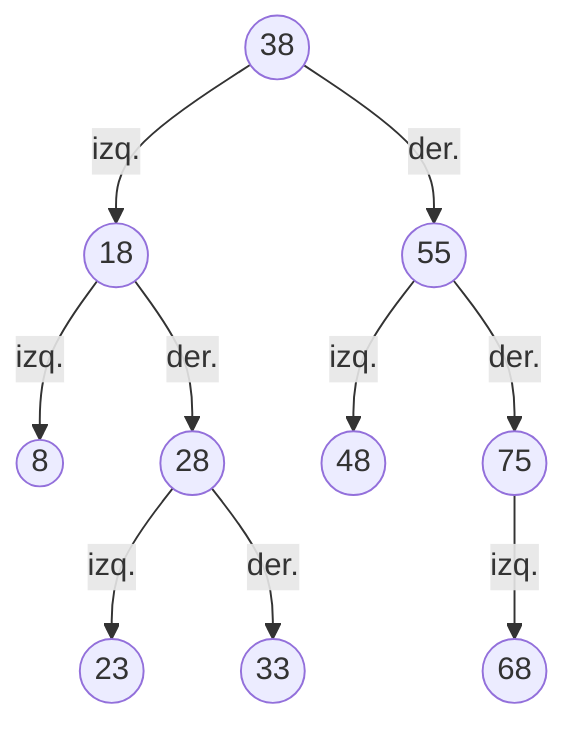
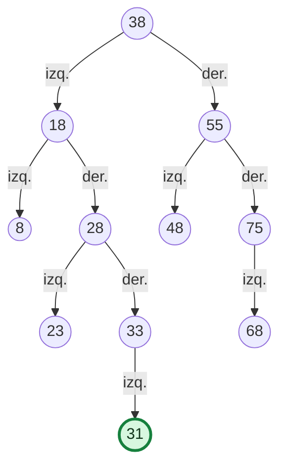

# Estación E1 · Inserción en un Árbol Binario de Búsqueda (ABB)

**APE 3 · Fase 2 · Grupo 2**  
**Responsable:** Kenneth · rama `Mateo-Chalco`  
**Tiempo de trabajo:** 7 minutos

## Objetivo

Construir un ABB a partir de una secuencia de matrículas y justificar el recorrido necesario para insertar una nueva matrícula sin alterar la propiedad de orden del árbol.

## Datos de la actividad

Inserta las siguientes matrículas **en el orden indicado**:

`38, 18, 55, 8, 28, 48, 75, 23, 33, 68`

**Matrícula adicional:** `31`.

### Ejercicio para los participantes

1. Dibuja el ABB que se obtiene después de insertar, una por una, las 10 matrículas de la lista.
2. Partiendo de la raíz, decide dónde se insertaría la matrícula **31**. Anota cada nodo que se compara, indica si vas a la izquierda o a la derecha y explica por qué.
3. Señala el **padre** del nuevo nodo y si 31 queda como hijo izquierdo o derecho.
4. Explica qué ocurriría si intentaras insertar 31 nuevamente en un ABB que no permite matrículas repetidas.
5. **Pregunta adicional:** ¿cuál es la altura del árbol antes y después de insertar 31, si la altura se mide en aristas y una hoja tiene altura 0?

**Entrega de la estación:** publica en el Padlet de tu grupo el dibujo del ABB y el camino de inserción de 31, acompañado de una breve explicación de las comparaciones.

---

## Solución para el facilitador

### 1. ABB de las 10 matrículas originales

**Recorridos de comprobación, antes de insertar 31:**

- **Preorden (raíz, izquierda, derecha):** 38, 18, 8, 28, 23, 33, 55, 48, 75, 68.
- **Inorden (izquierda, raíz, derecha):** 8, 18, 23, 28, 33, 38, 48, 55, 68, 75.
- **Posorden (izquierda, derecha, raíz):** 8, 23, 33, 28, 18, 48, 68, 75, 55, 38.
- **Altura original:** 3 aristas.

### 2. Inserción de la matrícula 31

| Paso | Nodo comparado | Comparación | Decisión |
|---|---:|---|---|
| 1 | 38 | 31 < 38 | Ir al hijo izquierdo: 18 |
| 2 | 18 | 31 > 18 | Ir al hijo derecho: 28 |
| 3 | 28 | 31 > 28 | Ir al hijo derecho: 33 |
| 4 | 33 | 31 < 33 | Ir al hijo izquierdo: está vacío |
| 5 | — | Se alcanzó una posición vacía | Crear el nodo 31 |

**Camino:** `38 → 18 → 28 → 33 → 31`.

**Ubicación:** la matrícula **31** se convierte en **hijo izquierdo de 33**. Es correcta porque 31 es mayor que 28 y menor que 33, sin romper las relaciones de orden del ABB.

### 3. ABB después de insertar 31

- **Cantidad total después de la inserción:** 11 nodos.
- **Altura después de insertar 31:** 4 aristas (camino 38 → 18 → 28 → 33 → 31).
- **Segundo intento de insertar 31:** la búsqueda llega al nodo 31 ya existente y **se rechaza el duplicado**, suponiendo la política del proyecto de no admitir matrículas repetidas. El árbol permanece igual.

### 4. Respuesta modelo para el Padlet

> Insertamos 31 siguiendo 38 (izquierda), 18 (derecha), 28 (derecha) y 33 (izquierda). Como el hijo izquierdo de 33 está vacío, 31 queda allí. El ABB pasa de 10 a 11 nodos y su altura sube de 3 a 4 aristas. Repetir la matrícula 31 no modifica el árbol porque no se admiten duplicados.

## Orientación para la facilitación (7 minutos)

- **Minuto 0–1:** presentar la lista y recordar que los menores van a la izquierda y los mayores a la derecha.
- **Minutos 1–4:** los equipos construyen el árbol y trazan la inserción de 31.
- **Minutos 4–6:** justifican la posición, comparan alturas y publican su respuesta en Padlet.
- **Minuto 6–7:** contrastar con la solución y explicar el rechazo de duplicados.

> **Nota:** la altura 3 indicada por Monica corresponde a las 10 matrículas originales de esta estación. No debe confundirse con la altura esperada del árbol organizacional del programa (`Altura: 4`), que corresponde a otra estructura.
